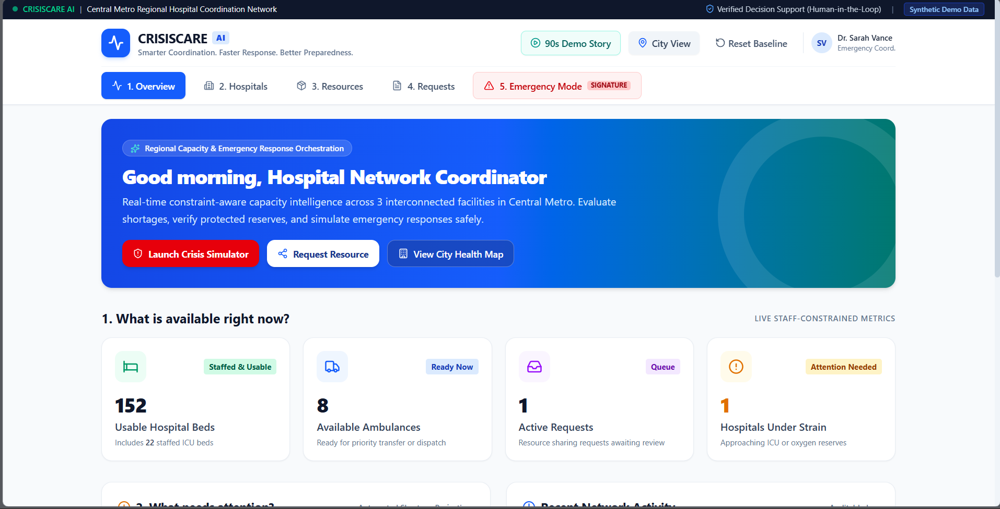
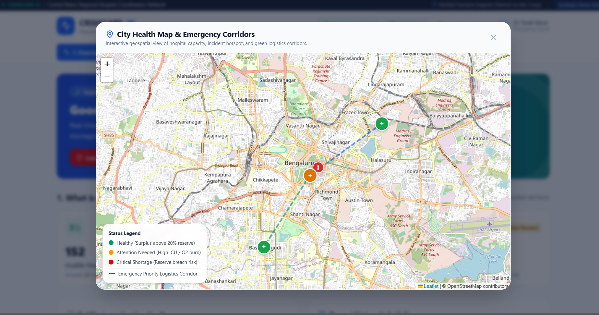

# 🏥 CrisisCare AI
### Adaptive Healthcare Coordination & Emergency Resource Intelligence Platform

**Smarter Coordination. Faster Response. Better Preparedness.**

CrisisCare AI is a healthcare emergency coordination platform designed to improve resource visibility, identify capacity shortages, and support informed decisions across interconnected hospitals.

Rather than treating hospitals as isolated facilities, CrisisCare AI explores how a regional healthcare network can respond collectively to shortages, emergency requests, and changing resource demands.

The platform brings together hospital capacity intelligence, resource coordination, geographic visualization, and human-verified decision support in a unified interface.

> **Project Status:** Engineering and hackathon prototype using synthetic demonstration data. Not intended for live clinical or emergency dispatch operations.

---

## 🌍 The Problem

During healthcare emergencies, hospitals may experience uneven resource distribution.

One hospital may face critical shortages while another facility has available capacity. Without effective coordination, emergency response can become fragmented and delayed.

Key challenges include:

- Limited visibility into regional hospital capacity.
- Difficulty tracking staffed beds, ICU resources, and ambulances.
- Uneven distribution of emergency medical resources.
- Delays in identifying facilities approaching critical shortages.
- Fragmented resource-sharing requests.
- Difficulty evaluating coordinated responses during emergencies.

**The central question behind CrisisCare AI is:**

> How can interconnected hospitals coordinate available resources, identify shortages, and respond more effectively during a healthcare crisis?

---

## 💡 Our Solution

**CrisisCare AI — Adaptive Healthcare Coordination Platform** provides a regional view of healthcare resources and emergency coordination.

The platform is organized around four goals:

1. **Monitor:** Understand hospital capacity and available resources.
2. **Identify:** Highlight facilities experiencing shortages or operational strain.
3. **Coordinate:** Support resource-sharing requests across hospitals.
4. **Simulate:** Explore emergency response scenarios in a controlled demonstration environment.

CrisisCare AI emphasizes **human-in-the-loop decision support**, keeping authorized people responsible for reviewing and approving important coordination decisions.

---

## ✨ Core Features

### 🏥 1. Regional Hospital Overview

Provides a centralized view of an interconnected hospital network.

The demonstrated interface includes:

- Regional capacity information.
- Staffed and usable hospital beds.
- Staffed ICU bed availability.
- Ambulance availability.
- Active resource-sharing requests.
- Hospitals requiring attention.

### 📊 2. Capacity Intelligence Dashboard

Displays important healthcare resource indicators in an accessible format.

The supplied demonstration screenshot shows:

| Indicator | Demo Value |
|---|---:|
| Usable Hospital Beds | 152 |
| Staffed ICU Beds | 22 |
| Available Ambulances | 8 |
| Active Requests | 1 |
| Hospitals Under Strain | 1 |
| Interconnected Facilities | 3 |

These values are from the synthetic demonstration scenario, not verified real-world hospital availability.

### 🚑 3. Resource Coordination

The application includes dedicated navigation for hospital resources and coordination requests.

The interface provides access to:

- Hospital information.
- Resource information.
- Resource-sharing requests.
- Emergency coordination workflows.

### 🚨 4. Emergency Simulation

The dashboard includes a dedicated **Emergency Mode** and a **Launch Crisis Simulator** action.

The simulation concept supports exploring how emergency scenarios may affect hospital capacity and regional resource coordination.

### 🗺️ 5. City Health Map

The application includes an interactive geographic view of the demonstration hospital network.

The supplied map screenshot shows:

- OpenStreetMap-based geographic visualization.
- Hospital status markers.
- Color-coded capacity indicators.
- Emergency priority logistics corridors.
- Interactive map navigation.
- A hospital status legend.

### 🛡️ 6. Human-in-the-Loop Decision Support

CrisisCare AI emphasizes verified decision support.

The interface explicitly communicates that important coordination decisions require human oversight rather than relying entirely on automated recommendations.

### 🎬 7. Guided Demonstration

The dashboard includes a **90s Demo Story** option, designed to introduce the project's capabilities through a guided demonstration.

### 🎨 8. Accessible Interface

The demonstrated interface uses:

- Clear navigation tabs.
- Readable metric cards.
- Color-coded resource indicators.
- Dedicated emergency actions.
- Simple map controls.
- Clearly labeled synthetic data.

---

## 📸 Application Screenshots

### 🖥️ 1. Healthcare Coordination Dashboard

The main dashboard provides a centralized overview of regional hospital resources, operational strain, and coordination activities.



**Highlights:**

- Regional hospital capacity overview.
- 152 usable beds in the displayed demonstration.
- 8 available ambulances.
- Active coordination requests.
- Hospital strain indicators.
- Emergency simulator access.
- Human-verified decision-support labeling.

### 🗺️ 2. City Health Map & Emergency Corridors

The interactive city health map presents hospital locations, capacity status, and emergency logistics corridors in a geographic interface.



**Hospital Status Legend:**

| Indicator | Meaning |
|---|---|
| 🟢 Green | Healthy — surplus above 20% reserve |
| 🟠 Orange | Attention needed — high ICU or oxygen consumption |
| 🔴 Red | Critical shortage — reserve breach risk |
| 🔵 Dashed Line | Emergency priority logistics corridor |

The displayed map uses OpenStreetMap attribution and Leaflet-based map controls.

**Note:** The screenshots represent a synthetic demonstration environment. They must not be interpreted as verified live hospital conditions.

---

## 🧠 What Makes CrisisCare AI Different?

| Traditional Challenge | CrisisCare AI's Approach |
|---|---|
| Hospitals viewed independently | Regional hospital network perspective |
| Fragmented capacity information | Centralized capacity dashboard |
| Resource shortages identified separately | Network-wide shortage visibility |
| Manual coordination information | Organized resource-sharing workflows |
| Limited geographic context | Interactive city health map |
| Difficulty evaluating emergency scenarios | Crisis simulation concept |
| Risk of unverified automated decisions | Human-in-the-loop decision support |

### Central Innovation

CrisisCare AI emphasizes **constraint-aware regional coordination**.

The goal is not simply to identify which hospital has available resources, but to consider whether those resources can be shared without compromising the supplying facility's own operational requirements.

---

## 🏗️ System Architecture

The following diagram represents the conceptual application workflow:

```text
              ┌──────────────────────────┐
              │ Hospital & Resource Data │
              └─────────────┬────────────┘
                            │
                            ▼
              ┌──────────────────────────┐
              │ Data Validation &        │
              │ Capacity Processing      │
              └─────────────┬────────────┘
                            │
                            ▼
              ┌──────────────────────────┐
              │ Resource Coordination    │
              │ & Constraint Evaluation  │
              └─────────────┬────────────┘
                            │
                            ▼
              ┌──────────────────────────┐
              │ Application / API Layer  │
              └─────────────┬────────────┘
                            │
                            ▼
              ┌──────────────────────────┐
              │ Dashboard, Hospital      │
              │ Views & City Health Map  │
              └─────────────┬────────────┘
                            │
                            ▼
              ┌──────────────────────────┐
              │ Human Review &           │
              │ Coordination Decisions   │
              └──────────────────────────┘
```

This is a conceptual architecture. The precise internal implementation should be verified against the source code.

---

## 🛠️ Technology Stack

The repository includes separate frontend and backend directories, Python dependency files, and Docker deployment configuration.

| Component | Technology |
|---|---|
| Frontend | [Confirm Actual Framework] |
| Backend | [Confirm Actual Framework] |
| Backend Dependencies | Python requirements files |
| Interactive Maps | Leaflet / OpenStreetMap |
| Database | [Confirm Database] |
| Analysis Engine | [Confirm Implemented Algorithms] |
| Containerization | Docker / Docker Compose |
| Deployment Configuration | Render |
| Version Control | Git & GitHub |

Replace unverified entries with the actual technologies used.

---

## 📁 Project Folder Structure

The following top-level structure is based on the files previously visible in the project directory, with an additional screenshots directory for this README.

```text
CRISISCARE_AI/
│
├── frontend/                    # Frontend application
│
├── backend/                     # Backend application
│
├── docs/                        # Project documentation
│   └── screenshots/
│       ├── dashboard.png
│       └── city-health-map.png
│
├── .dockerignore                # Docker exclusions
├── .env.example                 # Environment variable template
├── .gitignore                   # Git exclusions
│
├── Dockerfile                   # Docker image configuration
├── compose.yaml                 # Docker Compose configuration
├── render.yaml                  # Render deployment configuration
│
├── requirements.txt             # Python dependencies
├── requirements-dev.txt         # Development dependencies
│
├── README.md                    # Project documentation
├── DEPLOYMENT.md                # Deployment guide
└── VALIDATION.md                # Validation documentation
```

### Directory Overview

| File / Folder | Purpose |
|---|---|
| `frontend/` | User interface and interactive dashboard |
| `backend/` | Backend application and coordination logic |
| `docs/screenshots/` | Application screenshots for documentation |
| `Dockerfile` | Container build instructions |
| `compose.yaml` | Docker Compose configuration |
| `render.yaml` | Render deployment configuration |
| `requirements.txt` | Python runtime dependencies |
| `requirements-dev.txt` | Development dependencies |
| `.env.example` | Environment configuration template |
| `DEPLOYMENT.md` | Deployment instructions |
| `VALIDATION.md` | Validation documentation |

---

## 🚀 Installation & Setup

### Prerequisites

Depending on the configured application, you may need:

- Git
- Python
- Node.js and npm
- Docker and Docker Compose

### Step 1: Clone the Repository

```bash
git clone https://github.com/sharifasulthana0207-tech/CrisisCare-Ai.git
cd CrisisCare-Ai
```

### Step 2: Configure Environment Variables

Review `.env.example` and provide the environment variables required by the application.

Do not commit passwords, API keys, or private credentials.

### Step 3: Set Up Python Dependencies

```bash
python -m venv .venv
```

Activate the environment on Windows PowerShell:

```powershell
.venv\Scripts\Activate.ps1
```

Install dependencies:

```bash
pip install -r requirements.txt
```

### Step 4: Set Up the Frontend

If the frontend contains a Node.js `package.json`:

```bash
cd frontend
npm install
```

Use the appropriate scripts defined in `package.json` to start the application.

### Step 5: Run with Docker

If the Docker Compose configuration supports local startup:

```bash
docker compose up --build
```

Refer to `DEPLOYMENT.md` for the project's verified startup commands, ports, and environment configuration.

---

## 🎬 Demonstration Workflow

A suggested demonstration sequence is:

1. **Open the Dashboard:** Review regional hospital capacity and current synthetic metrics.
2. **Explore Hospitals:** Examine facilities within the demonstration network.
3. **Inspect Resources:** Review available resources and potential shortages.
4. **Review Requests:** Explore the resource coordination workflow.
5. **Open the City Health Map:** Observe hospital status and logistics corridors.
6. **Launch Emergency Mode:** Demonstrate the emergency simulation experience.
7. **Explain Human Oversight:** Show how the project prioritizes verified coordination decisions.

The interface also includes a **90s Demo Story** option for presenting the application.

---

## 🎯 Potential Applications

CrisisCare AI explores concepts relevant to:

- 🏥 Regional hospital coordination
- 🚑 Emergency resource management
- 🌍 Disaster preparedness
- 📊 Healthcare capacity intelligence
- 🗺️ Geographic healthcare visualization
- 🧠 Human-supervised decision support
- 🎓 Academic research and hackathon demonstrations

---

## 🔮 Future Enhancements

Potential future development includes:

### Real-Time Resource Integration
Connect authorized hospital resource feeds to support timely updates.

### Predictive Capacity Intelligence
Explore demand forecasting and early identification of potential shortages.

### Advanced Allocation Optimization
Evaluate resource-sharing possibilities while respecting staffing, safety, and reserve constraints.

### Multi-Region Support
Expand beyond a single demonstration hospital network.

### Emergency Notification System
Introduce verified alerts for significant resource or capacity changes.

### Explainable Recommendations
Communicate why particular resource coordination options are suggested.

### Role-Based Access
Provide appropriate permissions for hospital staff and regional coordinators.

### Data Quality Monitoring
Identify stale, incomplete, or inconsistent resource information.

### Mobile Accessibility
Improve usability across different devices and network conditions.

These are proposed enhancements, not claims of currently completed functionality.

---

## 🔐 Privacy, Safety & Responsible AI

CrisisCare AI is designed around responsible decision-support principles.

- **Human Oversight:** Important decisions require authorized human review.
- **Data Integrity:** Resource information must be validated before operational use.
- **Privacy:** Sensitive healthcare information must be protected.
- **Transparency:** Synthetic data must remain clearly identified.
- **Explainability:** Analytical outputs should communicate assumptions and uncertainty.
- **Security:** Access to sensitive operational information should be controlled.
- **Reliability:** Simulated availability must never be represented as verified real-world capacity.

**Medical and Emergency Disclaimer:** CrisisCare AI is an engineering prototype. It is not a certified medical device, an authorized emergency dispatch system, or a substitute for professional healthcare and emergency-management judgment.

---

## 🧪 Testing & Validation

The repository includes `VALIDATION.md` for documenting project validation.

Relevant areas include:

- Frontend functionality
- Backend API behavior
- Resource-data validation
- Dashboard calculations
- Emergency simulation workflows
- Map rendering
- Error handling
- Deployment checks

Only describe tests as passed after they have been successfully executed.

---

## 👥 Team & Contributions

**Project Name:** CrisisCare AI

**Project Theme:** Adaptive Healthcare Coordination

**Domain:** Healthcare Technology / Emergency Response

**Project Type:** Engineering & Hackathon Project

**Developed For:** MSME Hackathon

**Team Name:** [Add Team Name]

**Team Members:** [Add Contributors]

**Institution:** [Add College Name]

Contributions, technical suggestions, and constructive feedback are welcome.

---

## 📄 License

Refer to the repository's `LICENSE` file if one has been added.

Otherwise, no open-source license is currently specified.

---

## 🌟 Project Vision

Healthcare emergencies require more than isolated resource monitoring.

CrisisCare AI explores how interconnected hospitals can share a clearer understanding of capacity, resource pressure, and coordination needs.

By combining regional visibility, geographic intelligence, emergency simulation, and human-supervised decision support, the project aims to contribute toward more informed and resilient healthcare coordination.

---

### 🏥 CrisisCare AI
**Adaptive Healthcare Coordination Platform**

**Smarter Coordination. Faster Response. Better Preparedness.**

*Because in a crisis, every resource matters.*
