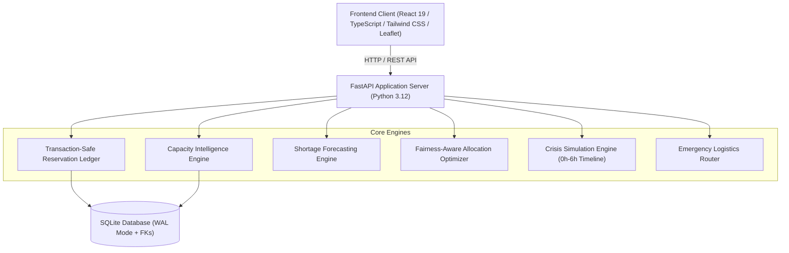

# CRISISCARE AI

> **Adaptive Healthcare Coordination & Emergency Response Platform**  
> *"Smarter Coordination. Faster Response. Better Preparedness."*  
> **Monitor → Predict → Simulate → Coordinate → Respond**

Deployment instructions: see **[DEPLOYMENT.md](DEPLOYMENT.md)**.
No public URL has been provisioned for this package.

---

## 1. Executive Summary

During mass-casualty incidents, epidemics, and sudden supply-chain disruptions, hospitals face rapidly fluctuating demand. While one hospital's emergency department is overwhelmed, neighboring facilities frequently have usable beds, surplus ventilators, or liquid oxygen reserves. However, traditional systems suffer from **fragmented visibility**, **delayed coordination**, and **cascading shortages** (solving one hospital's bottleneck by dangerously depleting another).

**CRISISCARE AI** is an intelligent, accessible, and explainable healthcare coordination decision-support platform. It unites real-time capacity intelligence, mathematical deficit forecasting, fairness-aware capability matching, transaction-safe reservation ledgers, and an interactive emergency crisis simulator.

---

## 2. Core Differentiator

Unlike basic hospital lookup directories or static bed dashboards, **CRISISCARE AI evaluates how resources can be coordinated across multiple hospitals without creating new shortages elsewhere.**

1. **Staff-Constrained Usable Capacity**: An empty ICU bed is not considered usable unless certified on-duty staff (1:2 nursing ratio) and essential equipment (monitors/ventilators) are available.
2. **Transaction-Safe Reservation Ledger**: Resources are tracked through strict operational states (`RESERVED`, `ALLOCATED`, `IN_TRANSIT`, `RECEIVED`, `RELEASED`). Duplicate allocations are prevented atomically.
3. **Protected Operational Reserve**: A donor hospital can **never** commit resources that would drop its available inventory below its protected safety threshold (default **20%**).
4. **Crisis Simulation & Intervention Comparison**: Evaluates emergency scenarios before actions are dispatched, quantitatively comparing 4 intervention strategies:
   - **Strategy A**: No Action (Siloed response)
   - **Strategy B**: Patient Transfer Diversion
   - **Strategy C**: Surplus Resource Sharing
   - **Strategy D**: Combined Response (Transfers + Resource Sharing + Green Priority Corridor)
5. **Human-Centered, Age-Friendly UI**: Clean, light-themed healthcare palette, readable typography (>=16px), large touch-friendly buttons, and zero medical jargon.

---

## 3. System Architecture



---

## 4. Primary Five-Section Navigation

1. **Overview**: Answers three immediate operational questions:
   - *What is available right now?* (Usable beds, ICU beds, ready ambulances)
   - *What needs attention?* (High-priority shortage alerts & burn-rate warnings)
   - *What should I do next?* (Quick action triggers to find, check, request, or simulate)
2. **Hospitals**: Full facility profiles (St. Jude Metro, Hope Valley, Riverside) tracking physical available vs. staffed usable capacity, capabilities, and protected reserves.
3. **Resources**: Multi-facility inventory ledger with mathematical shortage countdowns (time until 20% reserve breach).
4. **Requests**: 5-step guided coordination workflow (`Choose Resource` → `Enter Quantity & Urgency` → `Surplus Match Check` → `Human Review` → `Track Delivery`).
5. **Emergency Mode (Signature Feature)**: Reproducible emergency scenarios, 0h–6h interactive timeline slider, and 4-way intervention comparison.

### Secondary Accessible Tools
- **City Health Map**: Leaflet geospatial view displaying hospital status pins (green/amber/red), incident epicenters, and emergency transit corridors.
- **90-Second Demo Story**: Guided walkthrough implementing the complete narrative from the MSME Hackathon presentation slides.

---

## 5. Participating Demonstration Network

| Facility | Role | General Beds (Usable / Total) | ICU Beds (Usable / Total) | Ventilators (Free / Total) | Oxygen Stock | Ambulances |
|---|---|---|---|---|---|---|
| **St. Jude Metro Hospital** (`METRO-CENTRAL`) | Tertiary & Trauma Center | 26 / 220 | 3 / 35 (Critical) | 5 / 32 | 3,800 L (High Burn) | 3 Ready |
| **Hope Valley Medical Center** (`HOPE-VALLEY`) | Community & Pulmonary Hub | 58 / 140 | 11 / 20 (Healthy) | 12 / 22 (Surplus) | 6,800 L (Surplus) | 3 Ready |
| **Riverside Regional Clinic** (`RIVERSIDE-REG`) | Emergency & Triage Clinic | 46 / 90 | 8 / 12 (Healthy) | 11 / 16 (Surplus) | 4,900 L (Surplus) | 2 Ready |

---

## 6. Installation & Execution

Use Python 3.12 and Node.js 24. From this folder:

```bash
python -m venv .venv
# Windows: .venv\Scripts\activate
# macOS/Linux: source .venv/bin/activate
python -m pip install -r requirements.txt
cd frontend
npm ci
npm run build
cd ..
python -m uvicorn backend.main:app --host 0.0.0.0 --port 8000 --workers 1
```

Open http://localhost:8000. An empty database is initialized with synthetic demo
records on startup; existing records are preserved. For development, start the
backend with `--reload` and run `npm run dev` in a second terminal in `frontend`.
The development frontend is available at http://localhost:3000.

See [DEPLOYMENT.md](DEPLOYMENT.md) for hosting and persistent storage.

---

## 7. Running the Test Suite

Execute the automated test suite with pytest:
```bash
python -m pip install -r requirements-dev.txt
python -m pytest backend/tests -v
```

### Verified Test Cases:
- `test_usable_capacity_constraint_awareness`: Confirms ICU bed usable capacity respects nurse-to-patient staffing ratios.
- `test_protected_reserve_enforcement`: Confirms donor hospital cannot commit resources that violate its 20% protected safety reserve.
- `test_oxygen_forecasting_calculation`: Verifies mathematical burn-rate calculations and hours to reserve breach under standard and surge conditions.
- `test_crisis_mode_simulation_engine`: Tests reproducible multi-timeline scenario simulation across all 4 intervention strategies.
- `test_api_overview_endpoint`: Validates overview summary payload.
- `test_api_guided_request_workflow`: Verifies 5-step guided request submission and transaction-safe approval into the ledger.

---

## 8. Responsible Intelligence & Ethical Safeguards

1. **Human-in-the-Loop Decision Support**: CRISISCARE AI never autonomously dispatches patient transfers or requisitions hospital equipment. Every action requires explicit sign-off from an authorized healthcare coordinator.
2. **Honest Data Labeling**: All demonstration data is clearly identified as synthetic. Calculations are grounded in verified mathematical formulas rather than fabricated claims.
3. **Privacy by Design**: All patient reference identifiers (e.g. `PT-DEMO-901`) are synthetic and strictly anonymized. No private patient health information (PHI) is required or stored.
4. **Protected Donor Integrity**: Network optimization functions prevent any single facility from becoming a donor if it jeopardizes the donor's own patient community.
